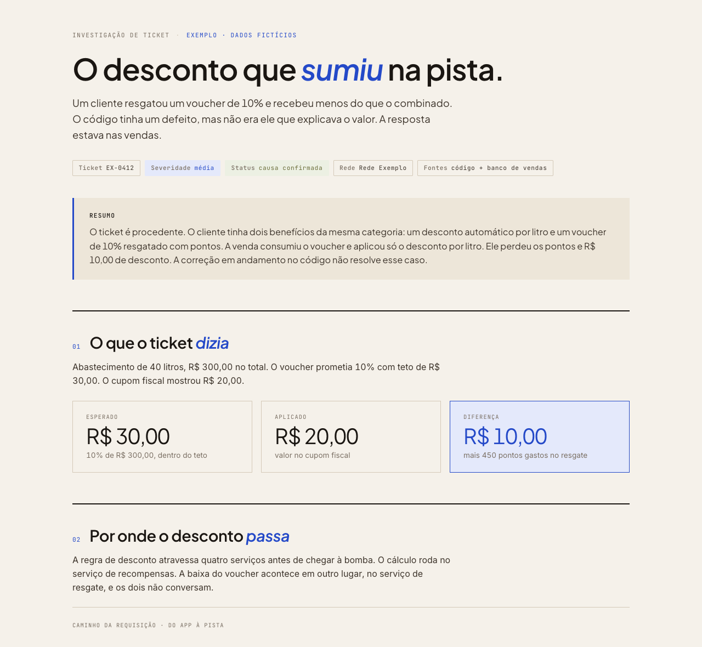

# html-artifacts

Skill para o [Claude Code](https://claude.com/claude-code) que transforma pedidos de documento (relatório, spec, investigação de bug, status, deck) em HTML standalone, com identidade visual consistente, tema claro e escuro e diagramas em SVG.



## Por que HTML

Quando o agente faz a busca, o gargalo passa a ser a atenção de quem lê. Um documento bem composto faz a pessoa parar e entender, em vez de fechar a aba depois de quinze linhas.

## Instalar

Na raiz do seu projeto:

```bash
git clone https://github.com/Dorolfo/Html-artifacts.git .claude/skills/html-artifacts
```

Para usar em todos os projetos, clone em `~/.claude/skills/html-artifacts`.

Abra uma nova sessão do Claude Code. A skill é carregada sozinha quando você pede um documento, por exemplo:

- "monta um relatório dessa análise"
- "escreve o post-mortem do incidente de ontem"
- "investiga esse ticket e me entrega um documento"

## O que tem dentro

| Arquivo | O que é |
|---|---|
| `SKILL.md` | quando acionar, fluxo de trabalho e regras |
| `references/design-system.md` | tokens, tipografia, componentes e como trocar a marca |
| `references/archetypes.md` | 16 tipos de documento com estrutura canônica |
| `references/svg-patterns.md` | padrões de diagrama em SVG |
| `references/anti-patterns.md` | o que evitar e checklist final |
| `assets/base-template.html` | ponto de partida com todos os componentes |
| `examples/investigacao-ticket.html` | exemplo completo, com dados fictícios |

## Adaptar à sua marca

A identidade que vem na skill é neutra. Para usar a sua, troque a cor de destaque e a fonte display no bloco de tokens de `assets/base-template.html`. O passo a passo está em `references/design-system.md`.

## Ver o exemplo

Abra `examples/investigacao-ticket.html` no navegador. Acrescente `?tema=escuro` ao endereço para ver o tema escuro.
