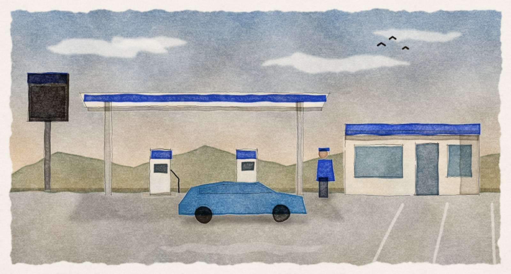

# html-artifacts

Skill para o [Claude Code](https://claude.com/claude-code) que transforma pedidos de documento em HTML standalone, com identidade visual consistente, tema claro e escuro e diagramas em SVG. Tem dois registros:

- **Documento:** relatório, spec, investigação de bug, status, deck. Feito para consultar e decidir.
- **Narrativa ilustrada:** história em capítulos, com aquarelas pintadas por código (OpenCV), cenas animadas e gráficos interativos. Feita para contar.


A aquarela abaixo não é imagem de banco nem de IA generativa. É uma cena descrita em JSON e pintada pelo `scripts/aquarela.py`, que simula tinta, borda úmida, granulação e papel:



## Por que HTML

Quando o agente faz a busca, o gargalo passa a ser a atenção de quem lê. Um documento bem composto faz a pessoa parar e entender, em vez de fechar a aba depois de quinze linhas.

## Instalar

Na raiz do seu projeto:

```bash
git clone https://github.com/Dorolfo/Html-artifacts.git .claude/skills/html-artifacts
```

Para usar em todos os projetos, clone em `~/.claude/skills/html-artifacts`.

Abra uma nova sessão do Claude Code. A skill é carregada sozinha quando você pede um documento, por exemplo:

- "monta um relatório dessa análise"
- "escreve o post-mortem do incidente de ontem"
- "investiga esse ticket e me entrega um documento"
- "conta a história desse projeto numa narrativa ilustrada"

## O que tem dentro

| Arquivo | O que é |
|---|---|
| `SKILL.md` | quando acionar, fluxo de trabalho e regras |
| `references/design-system.md` | tokens, tipografia, componentes e como trocar a marca |
| `references/archetypes.md` | 17 tipos de documento com estrutura canônica |
| `references/svg-patterns.md` | padrões de diagrama em SVG |
| `references/anti-patterns.md` | o que evitar e checklist final |
| `references/narrativa-ilustrada.md` | como montar uma narrativa: estrutura, metáforas e checklist |
| `references/aquarela-opencv.md` | como pintar por código |
| `references/cenas-e-dataviz.md` | como animar as cenas e fazer gráficos interativos |
| `assets/base-template.html` | ponto de partida do registro documento |
| `assets/narrativa.css` · `assets/narrativa-kit.js` | CSS e motor JS da narrativa |
| `scripts/aquarela.py` | pinta uma cena JSON em camadas; também trata fotos |
| `scripts/nova_narrativa.py` | cria o esqueleto de uma narrativa |
| `scripts/empacotar.py` | junta a pasta num HTML único |
| `examples/investigacao-ticket.html` | exemplo completo, com dados fictícios |

## Narrativa ilustrada na mão

Você não precisa do agente para testar a pintura. Com o [uv](https://docs.astral.sh/uv/) instalado:

```bash
python3 scripts/nova_narrativa.py minha-historia --titulo "Minha história"
uv run scripts/aquarela.py pintar minha-historia/cenas/abertura.json --out minha-historia/layers --preview previa.jpg
```

O `uv` instala OpenCV e NumPy sozinho na primeira execução. As três metáforas visuais que vêm no kit (bomba, rodovia e extrato) nasceram num contexto de varejo de combustível e servem de molde para você criar a sua.

## Adaptar à sua marca

A identidade que vem na skill é neutra. Para usar a sua, troque a cor de destaque e a fonte display no bloco de tokens de `assets/base-template.html`. O passo a passo está em `references/design-system.md`.

## Ver o exemplo

Abra `examples/investigacao-ticket.html` no navegador. Acrescente `?tema=escuro` ao endereço para ver o tema escuro.

## Licença

MIT. Use, adapte e redistribua à vontade. Veja [LICENSE](LICENSE).
